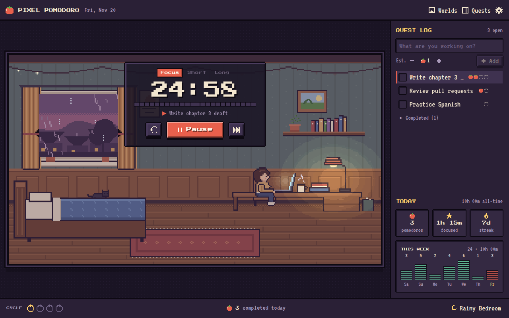
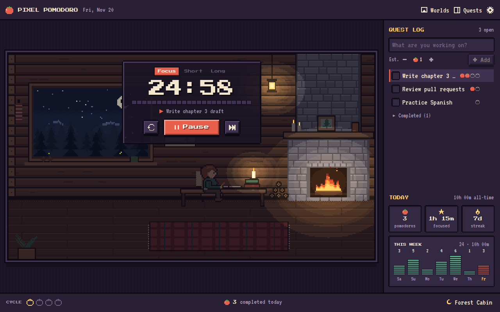
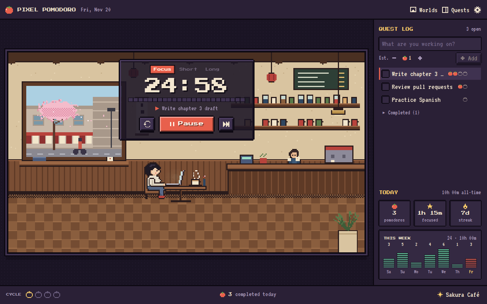
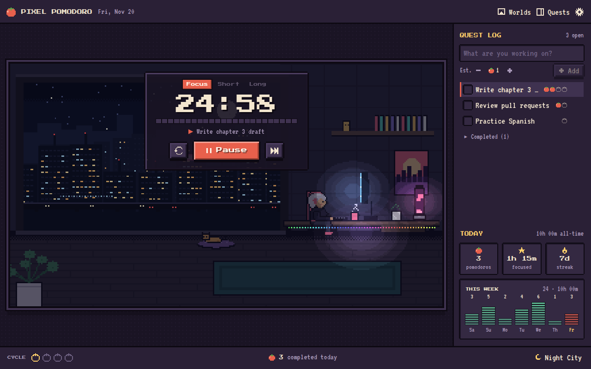
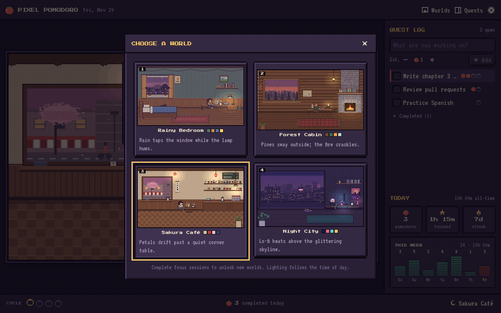
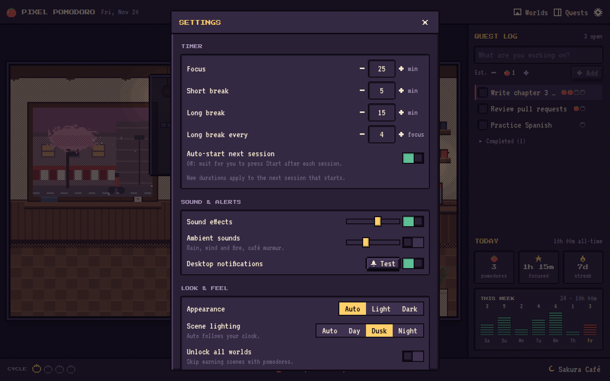

# Pixel Pomodoro

A cozy, offline Pomodoro timer for macOS, set inside tiny animated pixel-art worlds.
Built with **Tauri 2**, **React**, **TypeScript**, **Vite**, **Tailwind CSS** and **Zustand**.



## Screenshots

| Forest Cabin (night) | Sakura Café (day) |
| --- | --- |
|  |  |
| **Night City** | **Choosing a world** |
|  |  |

<p align="center">
  
</p>

## Features

- **Four worlds**: a rainy bedroom, a forest cabin with a crackling fire, a sakura café and a
  night-city apartment. Each one has its own palette, ambient animation and day / dusk / night
  lighting that follows your clock. New worlds unlock as you complete pomodoros. You can turn this
  off in Settings.
- **The character reacts to the timer**: it types or writes during focus, sips tea and stretches on
  breaks, and sits idle while the timer is paused.
- **Accurate timer**: remaining time is always computed from wall-clock timestamps
  (`endsAt - now`), never by counting ticks. It stays correct while the window is hidden, minimized
  or the Mac is asleep, and it catches up on any sessions that finished in the meantime.
- **Pomodoro flow**: 25 / 5 / 15 minute defaults, a long break after every 4 focus sessions, and
  automatic or manual transitions. Start, pause, resume, reset and skip.
- **Quest log (tasks)**: add tasks with a pomodoro estimate and pick the current one. Each
  completed focus session is credited to the current task.
- **Stats**: today's pomodoros and focus time, a day streak, all-time total and a 7-day chart.
- **Sound**: chiptune cues and optional ambient sound (rain, wind and fire, café murmur), all
  synthesized with Web Audio, so the app ships no audio files. Prefer your own background
  audio? In Settings → Ambient track, choose **My file** and pick an MP3, M4A, WAV, AIFF or FLAC
  (up to 200 MB). It loops in every world, uses the same volume slider, and is copied into the
  app's data folder so it keeps working if you move or delete the original.
- **Native macOS integration**: notifications when a session ends, an overlay title bar with the
  standard window buttons, and light and dark appearance (follows the system or can be set
  manually). Closing the window keeps the timer running; click the Dock icon to bring it back.

## Download and install

Pixel Pomodoro runs on **Apple Silicon Macs (M1 or newer) with macOS 11 Big Sur or later**. Intel
Macs aren't supported yet.

### 1. Download the app

**[⬇ Download Pixel-Pomodoro-macOS-arm64.dmg](https://github.com/GOGOJO/pixel-pomodoro/releases/latest/download/Pixel-Pomodoro-macOS-arm64.dmg)**

That link always points to the newest release. You can also browse every version and its
release notes on the [Releases page](https://github.com/GOGOJO/pixel-pomodoro/releases). If
you'd rather skip the installer, each release also has `Pixel-Pomodoro-macOS-arm64.app.zip`,
the bare app: unzip it and move it into Applications.

<details>
<summary>Want the very latest, unreleased build?</summary>

Every push to `main` also builds the app on GitHub Actions. Open the
[**Build** workflow runs](https://github.com/GOGOJO/pixel-pomodoro/actions/workflows/build.yml?query=branch%3Amain),
click the most recent run with a green check mark, and download
**Pixel-Pomodoro-macOS-arm64** under **Artifacts** (you need to be signed in to GitHub). The
zip contains `dmg/Pixel Pomodoro_<version>_aarch64.dmg` and the bare app. Or, with the
[GitHub CLI](https://cli.github.com/):

```bash
gh run download --repo GOGOJO/pixel-pomodoro --name Pixel-Pomodoro-macOS-arm64
```

</details>

### 2. Install it

1. Double-click `Pixel-Pomodoro-macOS-arm64.dmg`.
2. Drag **Pixel Pomodoro** onto the **Applications** folder in the window that opens.
3. Eject the disk image (the ⏏ button next to it in Finder's sidebar).

### 3. Open it the first time

The app isn't notarized by Apple, so macOS blocks the first launch. You only need to do this
once:

1. Open **Pixel Pomodoro** from Applications. macOS says it can't verify the developer; click
   **Done** (or **Cancel**).
2. Open **System Settings → Privacy & Security**, scroll down to the message about
   Pixel Pomodoro and click **Open Anyway**, then confirm with your password.

If macOS instead says the app **"is damaged and can't be opened"**, it's the download quarantine
flag, not real damage. Clear it in Terminal, then open the app normally:

```bash
xattr -cr "/Applications/Pixel Pomodoro.app"
```

Allow notifications when asked so you hear about finished sessions even when the window is
closed.

### Updating and uninstalling

- **Update**: download the newest release and drag it into Applications again, replacing the old
  copy. Your tasks, settings and history are kept.
- **Uninstall**: drag the app to the Trash. To also delete your data, remove
  `~/Library/Application Support/app.pixelpomodoro.desktop/`.

## Keyboard shortcuts

| Key | Action |
| --- | --- |
| Space | Start / pause / resume |
| R | Reset current session |
| S | Skip to next session |
| T | New task |
| 1 – 4 | Switch world |
| ⌘ , | Settings |

## Development

Requirements: Node 20+, Rust (stable) and Xcode Command Line Tools on macOS.

```bash
npm install
npm run app:dev      # native window with hot reload
npm test             # timer engine unit tests
npm run typecheck
```

`npm run dev` serves the UI in a normal browser, which is handy for quick UI work. In that mode
data is stored in `localStorage` instead of files.

## Building the macOS app

```bash
rustup target add aarch64-apple-darwin
npm run app:build:mac
```

Outputs (no dev server needed; all assets are embedded):

- `src-tauri/target/aarch64-apple-darwin/release/bundle/macos/Pixel Pomodoro.app`
- `src-tauri/target/aarch64-apple-darwin/release/bundle/dmg/Pixel Pomodoro_1.0.0_aarch64.dmg`

The GitHub Actions workflow (`.github/workflows/build.yml`) builds both on an Apple Silicon
runner, launches the app as a smoke test and uploads the DMG and a zipped `.app` as artifacts.

To publish a release, bump `version` in `src-tauri/tauri.conf.json` (and `package.json`), merge
to `main`, then push a matching tag:

```bash
git tag v1.0.1 && git push origin v1.0.1
```

The workflow checks that the tag matches the app version, builds the app and attaches
`Pixel-Pomodoro-macOS-arm64.dmg` and `Pixel-Pomodoro-macOS-arm64.app.zip` to a new GitHub
release.

The bundle is ad-hoc signed, not notarized, so downloaded copies need the first-launch steps in
[Download and install](#3-open-it-the-first-time). To distribute it more widely, set
`bundle.macOS.signingIdentity` to your Developer ID and notarize it.

## Where data lives

Settings, tasks, session history and the running timer are saved as JSON files in
`~/Library/Application Support/app.pixelpomodoro.desktop/`. Writes are atomic: each file is
written to a temp file, then renamed. A custom ambient track is stored next to them as
`custom-ambience.audio`.

## Project layout

```
src/
  lib/timerEngine.ts     pure, timestamp-based timer state machine (+ tests)
  lib/audio.ts           Web Audio chiptune cues and ambient sound
  lib/notify.ts          native notifications (Tauri plugin, web fallback)
  lib/storage.ts         Zustand storage adapter → Rust file commands
  store/                 settings, tasks, history, timer (Zustand + persist)
  scenes/                320×180 canvas renderer, characters and the four worlds
  components/            PomodoroTimer, PixelEnvironment, SceneSelector, TaskManager,
                         SessionTracker, SettingsPanel, AudioManager, …
src-tauri/               Tauri 2 shell: window config, load/save commands, notifications
scripts/make-icon.mjs    generates the pixel-art app icon (npm run icons)
```

All artwork (scenes, sprites, icon) is original and drawn in code. The fonts are
[Press Start 2P](https://fonts.google.com/specimen/Press+Start+2P) and
[VT323](https://fonts.google.com/specimen/VT323) (SIL Open Font License), bundled locally via
Fontsource.
